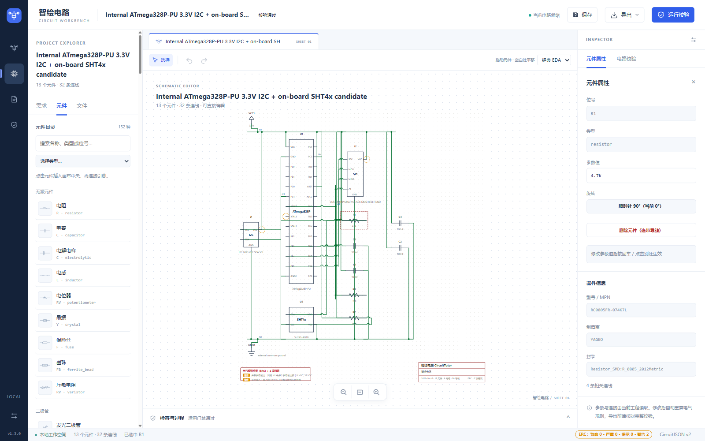
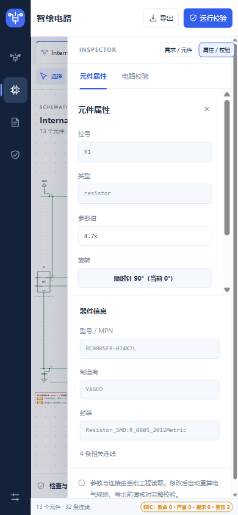

# 智绘电路 · CircuitTutor

> 用中文描述电路需求，在本机生成可编辑的原理图，再用确定性门禁（ERC / 额定值 / ngspice / KiCad 官方 ERC）复验，最后导出 SVG、BOM、SPICE、KiCad 工程与 PCB 候选。

当前产品版本：1.4.0。

[](LICENSE)
[](https://www.python.org/)
[](#为什么是零依赖)




<sub>窄屏布局：</sub> 

---

## 这是什么

一个**本地优先**的电路设计助手。左侧用中文描述需求（或粘贴图片、TSX 代码、外部工具结果），中间得到一张可拖动、可改参、可连线、可撤销的真实原理图，右侧看到真实元件属性与校验结果，底部可查生成过程与检查明细。

它不追求"AI 说什么就是什么"：**生成的候选必须经过确定性门禁才能被接受**，未运行的工具会如实显示"未完成"，而不是当作通过。

## 核心能力

- **中文需求 → 电路**：152 类元件目录、40 个内置模板与本地匹配器，缺供电、缺 I2C 地址等关键条件时先向你澄清。
- **真实可编辑原理图**：鼠标选中、拖动、引脚连线、缩放、改参数、撤销（Ctrl+Z），参数修改进入真实撤销栈。
- **确定性电气校验**：33 条 ERC 规则（短路、悬空、极性、LED 缺限流、缺去耦等）+ 额定值核对，不是模型自评。
- **外部工具复验**：本机 ngspice 跑 SPICE（op/ac/tran/dc），KiCad 官方 CLI 跑 ERC 与网表比对，导出完整 KiCad 工程。
- **教学时序图**：教学模式下的瞬态时序图由真实 `.tran` 输出绘制，并标注阈值与采样行数。
- **多入口生成**：图片识别（本机 CircuitVision）、代码建电路（tscircuit TSX）、外部结果导入（CircuitVision / HCD / tscircuit）。
- **分组导出**：原理图与物料（SVG / BOM / KiCad）、SPICE 仿真、PCB 与制造候选。
- **教学模式**：术语解释气泡、学习路径（需求→生成→审核→校验→导出）、门禁"为什么查这项"、新手引导与元件教学卡；默认关闭，只影响呈现，不改变电路与校验结果。

## 快速开始

需要 **Python 3.10+**，仅此而已。运行时零第三方依赖，无需 `pip install`。

```bash
git clone <this-repo>
cd 智绘电路
python server.py
```

然后打开 <http://127.0.0.1:8765/>。Windows 上也可以直接双击 `启动演示.bat`。

用 Docker：

```bash
docker compose up --build
```

### 可选：接入在线大模型

不配 Key 也能完整跑通——匹配到模板的需求会走本地离线路径。想用在线模型生成（自由需求、增量改图）：

```bash
cp .env.template .env
# 在 .env 中填入 DEEPSEEK_API_KEY
```

### 可选：启用外部工具复验

装了 `kicad-cli` 与 `ngspice` 后，对应的门禁会真正执行并给出官方结论；没装则如实显示"未完成"。

```bash
export KICAD_CLI_PATH=/path/to/kicad-cli
export NGSPICE_PATH=/path/to/ngspice
```

## 配置

全部通过环境变量或 `.env` 配置，默认值如下（与 `core/config.py` 一致）：

| 变量 | 默认 | 说明 |
|---|---|---|
| `LSQC_HOST` | `127.0.0.1` | 监听地址；仅本机可访问 |
| `LSQC_PORT` | `8765` | 监听端口 |
| `DEEPSEEK_API_KEY` | `（空）` | 未配置时只走本地模板，不调用在线模型 |
| `LLM_TIMEOUT_S` | `90` | 单次模型调用超时（秒） |
| `LLM_RETRIES` | `2` | 模型调用失败重试次数 |
| `LLM_STRUCT_RETRIES` | `2` | 结构化输出重试次数 |
| `LLM_ERC_RETRIES` | `1` | 带 ERC 反馈的重试次数 |
| `LLM_BUDGET` | `5` | 单次生成允许的模型调用预算 |
| `LLM_MAX_TOKENS` | `4096` | 单次响应最大 token |
| `MAX_QUERY_LEN` | `500` | 需求文本最大长度 |
| `KICAD_CLI_TIMEOUT_S` | `90` | 单次 KiCad CLI 超时（秒） |
| `KICAD_CLI_PATH` | `（自动探测）` | 未设置时在 PATH 与工具链中查找 |
| `NGSPICE_PATH` | `（自动探测）` | 未设置时在 PATH 与工具链中查找 |
| `LSQC_RATE_LIMIT` | `30` | 每 IP 每分钟 LLM 端点请求上限，`0` 关闭 |
| `LSQC_KICAD_RATE_LIMIT` | `20` | 每 IP 每分钟 KiCad 端点请求上限 |
| `LSQC_SSE_HEARTBEAT_S` | `15` | SSE 心跳间隔（秒） |
| `LSQC_LOG_LEVEL` | `INFO` | 日志级别 |

**端口回退**：若未设置 `LSQC_PORT`，但环境里存在标准变量 `PORT`（部分云平台会自动注入），服务会采用它并绑定 `0.0.0.0:PORT`。`PORT` 是外部环境变量名，与内部解析后的端口常量同名不同义，因此不列入上表。

## 项目结构

```
智绘电路/
├── server.py            # 标准库 HTTP 服务与全部 API 路由
├── core/                # 领域逻辑：目录、模板、ERC、SPICE、KiCad、PCB、集成桥
├── web/                 # 原生 JS 前端（无构建步骤、无框架）
├── tests/               # 测试套件与统一跑测入口
├── tools/               # 构建、归档、工具链激活等脚本
├── docs/                # 用户手册、API、架构与说明文档
├── data/                # 少量运行所需数据与示例
└── third_party/         # 第三方来源归因（见下）
```

## 测试

统一入口是 `tests/run_tests.py`，按能力分组：

```bash
python tests/run_tests.py --profile fast      # 快速核心
python tests/run_tests.py --profile eda       # 电气/EDA 相关
python tests/run_tests.py --profile release   # 交付打包（需本地 7-Zip）
python tests/run_tests.py --profile all       # 全部
```

前端为原生 JS，相关契约由 Node 测试覆盖：

```bash
node tests/test_frontend.js
node tests/test_workbench_ui.js
```

> 部分验收套件依赖本地归档证据（`evidence/`，体积很大且不入库），在全新克隆上会跳过或不可用；核心与 EDA 套件不依赖它。

## 架构

前端原生 JS ↔ 标准库 HTTP 服务 ↔ 领域模块（目录/模板/ERC/SPICE/KiCad/PCB）↔ 外部工具桥（ngspice、kicad-cli、tscircuit、CircuitVision）。

生成链路是分阶段的：**中文需求 → 澄清 → 候选电路 → 全目录结构校验 → 电气门禁 → 人工审核 → 应用/编辑/撤销**。每个阶段的产物与结论分开记录，模板回退不记为 AI 生成成功，预览完成不等于通过电气验收。

细节见 [docs/作品说明书.md](docs/作品说明书.md)、[docs/架构-生成精确性.svg](docs/架构-生成精确性.svg) 与 [docs/API.md](docs/API.md)。

## 为什么不夸大

- 制造类输出始终 `manufacturing_release=false`，需电子工程师与板厂复核。
- 未安装或未运行的工具显示"未完成"，不以估算替代结论。
- 图片识别与几何候选都需要人工确认器件、数值与引脚网络，交叉点不会自动成为电气网络。
- 教学时序图来自真实仿真输出，但阈值数字化会丢失模拟细节，不是实测波形。

## 第三方与许可

本项目自身以 **MIT** 许可发布，见 [LICENSE](LICENSE)。同时复用了若干开源项目，各自的来源、固定版本与许可事实记录在 [docs/开源项目集成.md](docs/开源项目集成.md) 与 `third_party/`：

| 上游 | 用途 | 许可 |
|---|---|---|
| [tscircuit](https://github.com/tscircuit/tscircuit) | 代码（TSX）建电路 | MIT / ISC |
| [CircuitVision](https://github.com/JKc66/CircuitVision) | 本机图片识别 | Apache-2.0 |
| [HCD](https://github.com/wanghaoyu6661/Hand-Drawn-Circuit-Diagram-Recognition) | 手绘几何候选（6 个算法） | **根许可证未明确**，仅本地/私有使用，不声明为可再分发 |
| [wavedrom](https://github.com/wavedrom/wavedrom) | 教学瞬态时序图渲染 | MIT |
| KiCad 官方库与 CLI | ERC / DRC / 封装 | 库 CC BY-SA 4.0；CLI GPL |
| ngspice | SPICE 仿真 | 见上游 |

上游源码快照中的大体积部分（`third_party/upstream/CircuitVision`、`third_party/upstream/HCD`）保留在本地但不入库。逐项文件哈希与边界说明见 [third_party/](third_party/) 下的归因文件。

## 贡献

欢迎提交 issue 与 PR，请先阅读 [CONTRIBUTING.md](CONTRIBUTING.md)。安全问题请按 [SECURITY.md](SECURITY.md) 私下报告。

## 文档索引

| 文档 | 内容 |
|---|---|
| [用户手册](docs/用户手册.md) | 界面操作与常见流程 |
| [API](docs/API.md) | 全部 HTTP 接口与参数 |
| [作品说明书](docs/作品说明书.md) | 系统设计与实现说明 |
| [开源项目集成](docs/开源项目集成.md) | 第三方来源、许可与边界 |
| [演示说明](docs/演示说明.md) | 建议演示顺序 |
| [交付与验收记录](docs/交付与验收记录.md) | 历史交付与验收记录（归档） |
